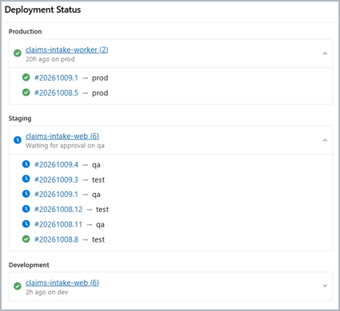
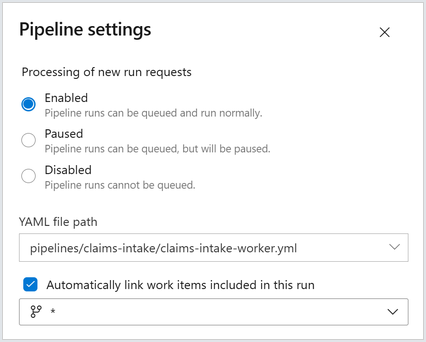
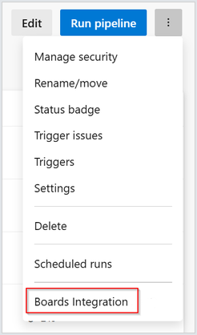
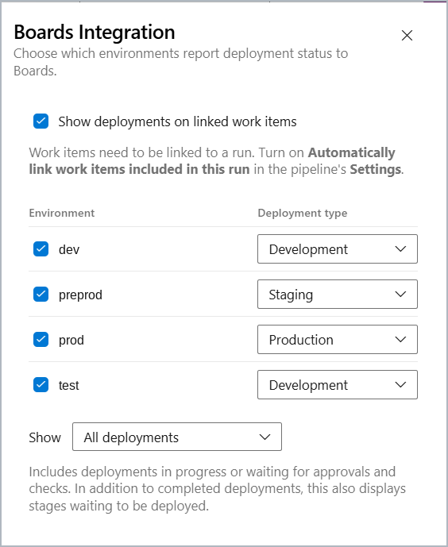
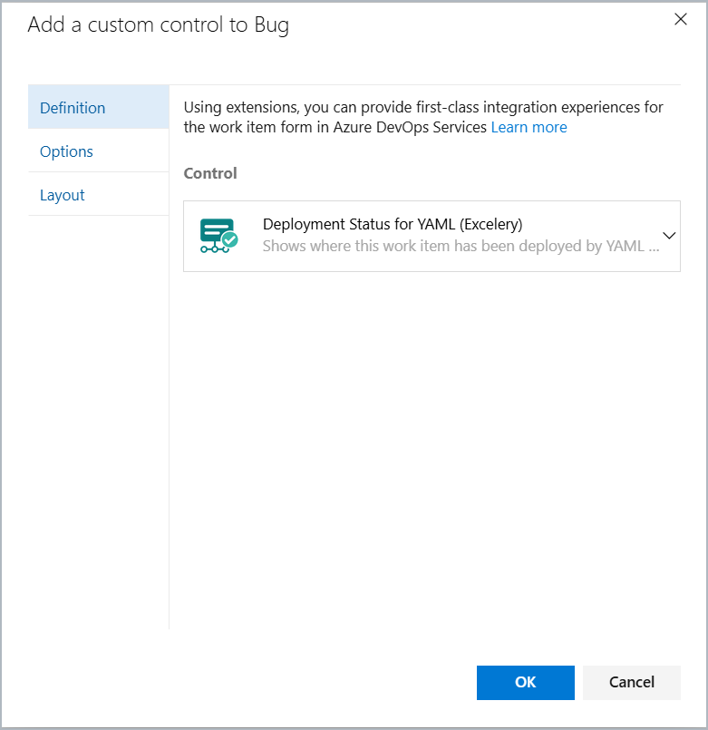
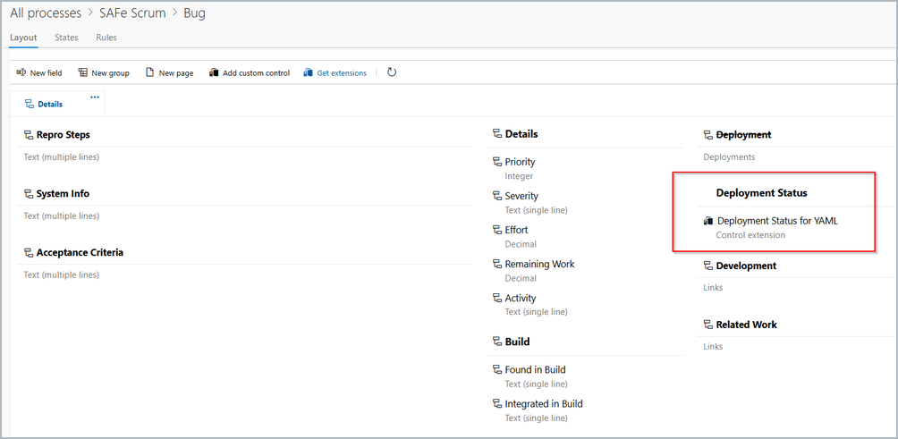

# Deployment Status to Boards for YAML

This extension brings the Classic release pipeline feature [Automatically link work items to releases and report deployment status to a work item](https://learn.microsoft.com/en-us/azure/devops/pipelines/integrations/configure-pipelines-work-tracking#classic-report-boards) to YAML pipelines that deploy to Azure DevOps environments.

The Azure DevOps team has this feature on the [roadmap](https://learn.microsoft.com/en-us/azure/devops/release-notes/roadmap/2024/boards-yaml-stage-status-on-work-item). But until there is built-in support for this, this extension can bridge the gap.

The extension adds a custom control to Azure Boards work item forms that shows deployment status for YAML pipelines, in the same style as the classic Deployment control. Instead of relying on Integrated in release stage links, it finds the runs that belong to the work item and lists their [Deployment Jobs](https://learn.microsoft.com/en-us/azure/devops/pipelines/process/deployment-jobs?view=azure-devops) that target [Environments](https://learn.microsoft.com/en-us/azure/devops/pipelines/process/environments?view=azure-devops).

Runs are found in three ways:

- Completed runs: the associated build is identified using the work item's Integrated in build links.
- Runs in progress, for example waiting for an approval, which is common for multi-stage pipelines: the extension identifies the associated builds using the commits or pull requests linked to the work item.
- Other completed runs of the same pipeline that were built from the same commit as a linked run. A pipeline that builds a commit again for the next environment gets no work items on the second run, because Azure DevOps lists only the commits since the last successful run, so that run has no Integrated in build link.

Integrated in build links are only added when a run completes, which is why runs in progress are found separately.

Runs built from a Git tag do not get an Integrated in build link, so they are shown only while they are in progress.

The extension does not write data to work items; it only reads existing links. Uninstalling it will not affect your work items or any existing data.

## Get started

### 1. Enable automatic work item linking

In your pipeline, open Settings and turn on Automatically link work items included in this run. This is what creates the Integrated in build links on the work items.

### 2. Configure Boards Integration

In pipeline menu, open ⋯ > Boards Integration.

Choose a deployment type for each environment.

A work item shows one deployment per environment: the first run that deployed it successfully, or, when none has, the earliest run that is running or waiting for an approval. Later runs of the same pipeline contain the change as well, but do not introduce it.

Choose which deployments to show:

| Symbols | Option | What is shown |
|---|---|---|
|  | All deployments (default) | Includes deployments in progress or waiting for approvals and checks. In addition to completed deployments, this also displays stages waiting to be deployed. |
|  | Completed deployments | Includes completed deployments from runs still in progress. This is typically the case for multi-stage pipelines waiting for a deployment to the next stage, where the pipeline has not yet created an Integrated in build link. |
|  | Completed runs only | Includes only deployments from completed runs. This is typically the case for a pipeline deploying to a single stage only. |

### 3. Add the new control to your work item forms

Open Organization settings > Process and select your process. For each work item type where you want deployment status displayed, open Layout.

Add a new Deployment group, in the same column.

Add the Deployment Status for YAML custom control to the group.

The Deployment group with the custom control appears in the layout, in the same column as the built-in sections.

If not needed for classic release pipelines, Hide the built-in Deployment section.

## Permissions and privacy

This extension requires read-only access to work items and builds. No data leaves your Azure DevOps organization. See [PRIVACY.md](https://github.com/excelery/azdo-extension-deployment-status/blob/main/PRIVACY.md).

## Support

Report bugs and request features through [GitHub Issues](https://github.com/excelery/azdo-extension-deployment-status/issues). Work item linking is a fairly complex area. Before reporting a problem, check that the pipeline and the extension are configured as described above, and read [SUPPORT.md](https://github.com/excelery/azdo-extension-deployment-status/blob/main/SUPPORT.md), which lists the common causes. Please check existing issues before opening a new one.

To report a vulnerability, follow [SECURITY.md](https://github.com/excelery/azdo-extension-deployment-status/blob/main/SECURITY.md).

## Contributing

See [CONTRIBUTING.md](https://github.com/excelery/azdo-extension-deployment-status/blob/main/CONTRIBUTING.md) for contribution guidelines.

